<picture>
  <source media="(prefers-color-scheme: dark)" srcset="assets/hero-dark.svg">
  <source media="(prefers-color-scheme: light)" srcset="assets/hero-light.svg">
  
</picture>

I'm Honey Badger. I've been writing code since 1996. These days I build mods, servers and tools for the games I play, on my own. The screenshots below come straight from the projects.

### COMM-LINK

**24 Oct 2026.** The War Room and the Bounty Board are registered on the EVE Frontier Dapp Index. 
**22 Oct 2026.** Shipped the War Room depth release for Cycle 7 on Stillness. 
**10 Oct 2026.** Named the Rust server Honey Badger and put my first plugin on it. 
**2 Oct 2026.** Battle Aura 3.1.1 for WoW Forever uploaded to CurseForge. WoWInterface has it too. 
**29 Sep 2026.** Republished the Bounty Board contract for Cycle 7.

<picture>
  <source media="(prefers-color-scheme: dark)" srcset="assets/telemetry-dark.svg">
  <source media="(prefers-color-scheme: light)" srcset="assets/telemetry-light.svg">
  
</picture>

Numbers from one run of the War Room engine's own check tool on 24 Oct 2026. A snapshot, not a live feed.

### THE ARMORY

#### War Room &nbsp;EVE Frontier

PvP intel built from public chain events. It shows kills and killers, and how late each killmail reached the chain, which is often hours. The chain doesn't show who is online, and neither does the War Room.

<a href="https://honeybadger.software/frontier/warroom/">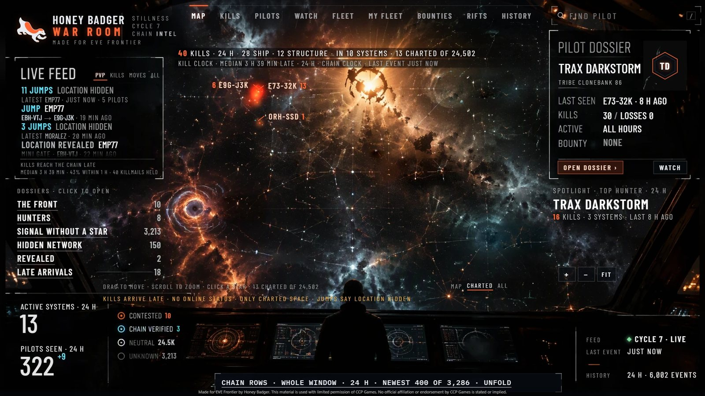</a>
<a href="https://honeybadger.software/frontier/warroom/">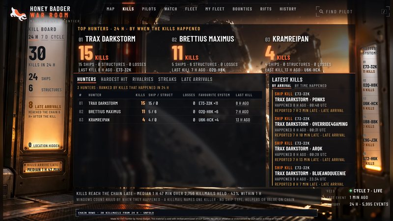</a><a href="https://honeybadger.software/frontier/warroom/">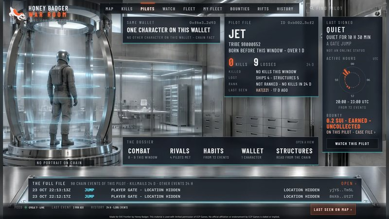</a><a href="https://honeybadger.software/frontier/warroom/">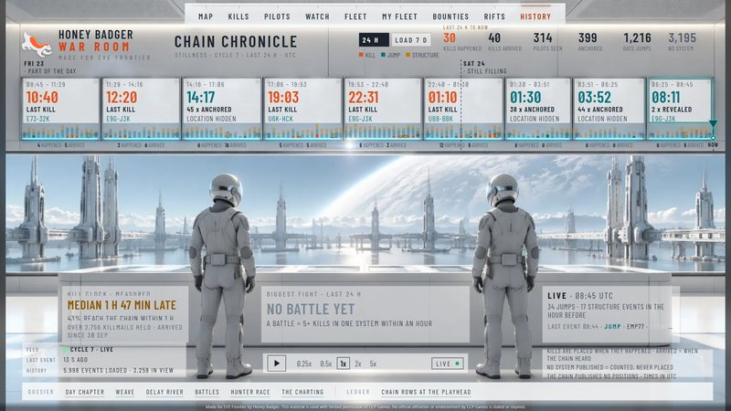</a>

Kills: top hunters, streaks, late arrivals. &nbsp; Dossier: kills, losses, same-wallet characters, last signed action. &nbsp; History: the last 24 hours, split into parts of the day.

#### Bounty Board &nbsp;EVE Frontier

Post a bounty on any pilot. If the target loses a ship before it runs out, the contract lets the killer claim it, with the game's own killmail as proof. No platform fee, just network gas. Nobody has collected one yet, so that last step is still untested. "Earned" on the board means a kill qualified, not that it was paid.

<a href="https://honeybadger.software/frontier/bounty/">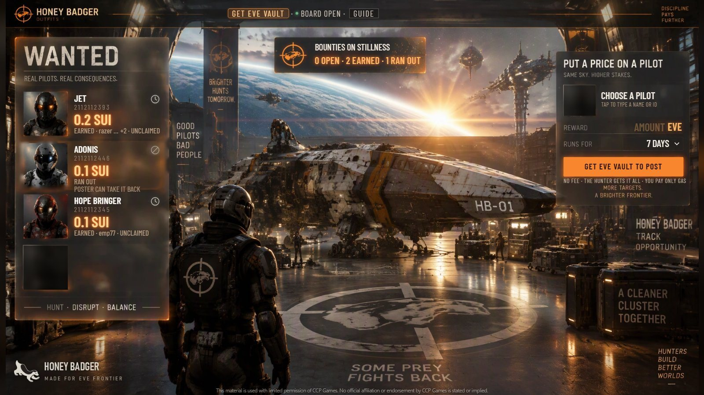</a>

#### Honey Badger &nbsp;Rust server

My own Rust server, running Carbon. The HUD across the top of these frames is mine. The gate and the vault were placed by my build plugin from saved layouts.

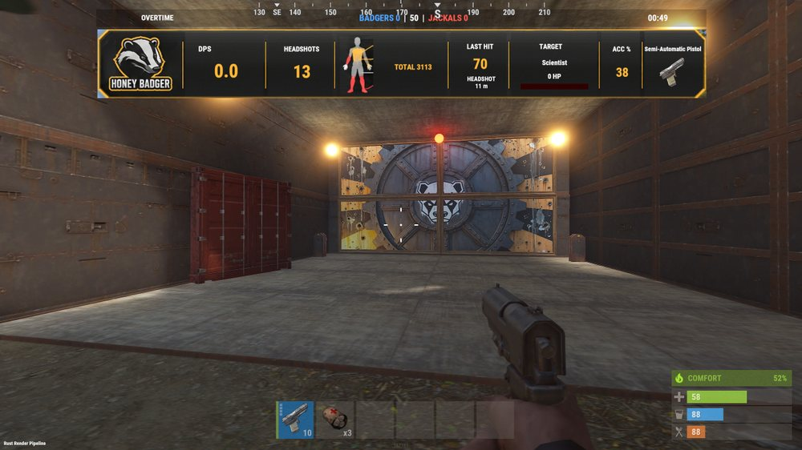

Build: places whole structures from saved layouts. &nbsp; Map Forge: edits terrain layers and saves a new .map. &nbsp; DPS HUD: damage, headshots, last hit, target, accuracy. &nbsp; TDM: two-team deathmatch.

#### Battle Aura &nbsp;WoW Forever

A personal damage meter with a battle scene behind the numbers. Total damage, biggest hit and DPS. Hits float up over the scene, and a banner marks a new personal best.

<a href="https://www.curseforge.com/wow/addons/battle-aura">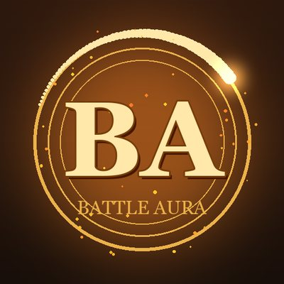</a>

[CurseForge](https://www.curseforge.com/wow/addons/battle-aura) &nbsp; [WoWInterface](https://www.wowinterface.com/downloads/info27234-BattleAura.html) &nbsp; [Source](https://github.com/honeybadger-software/battle-aura)

#### EVE Fleet Foreman &nbsp;EVE Online

Free mining helper. Ranks ores by ISK per m³ from Jita prices, tells you whether to refine or sell, and works out the fleet split from the Mining Ledger.

<a href="https://github.com/honeybadger-software/eve-fleet-foreman">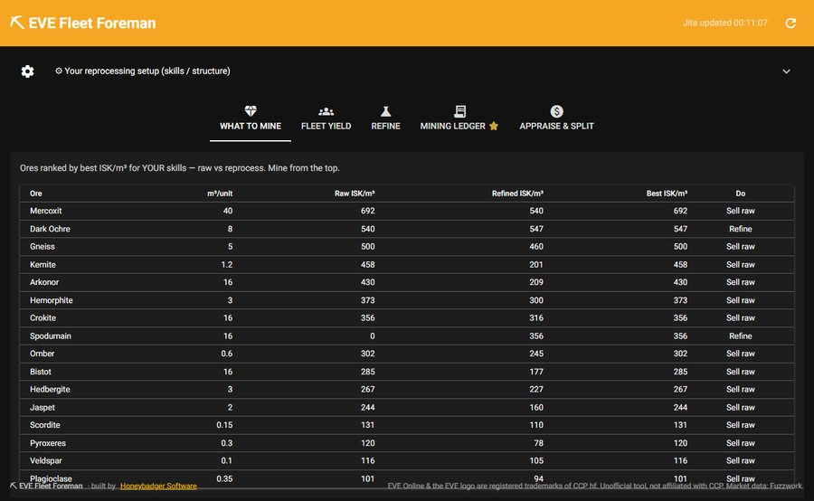</a><a href="https://github.com/honeybadger-software/eve-fleet-foreman">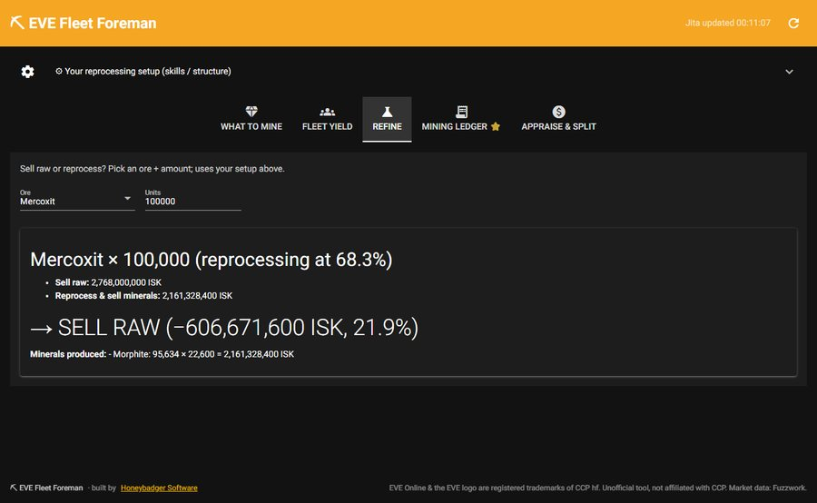</a>

### ACTIVE DEPLOYMENTS

**War Room** &nbsp; PvP intel for EVE Frontier 
React 19, TypeScript, Vite. Reads Sui testnet through GraphQL and a gRPC-web stream, and falls back to polling when the stream drops. Source is private. 
[honeybadger.software/frontier/warroom](https://honeybadger.software/frontier/warroom/)

**Bounty Board** &nbsp; on-chain bounties for EVE Frontier 
Move contract `hb_bounty::bounty_board` on Sui testnet (Stillness), React front end. Package `0xeb16...c7147`. 
[honeybadger.software/frontier/bounty](https://honeybadger.software/frontier/bounty/) &nbsp; [source](https://github.com/honeybadger-software/eve-frontier-bounty-board)

**Honey Badger** &nbsp; modded Rust server 
C# plugins on Carbon, using the Oxide and Carbon plugin APIs. Listed in the Rust server browser under Modded. Source is private.

**Battle Aura** &nbsp; WoW Forever addon 
Lua on Blizzard's own damage meter API (C_DamageMeter), so it works with Forever's restricted combat data. 
[curseforge.com/wow/addons/battle-aura](https://www.curseforge.com/wow/addons/battle-aura) &nbsp; [source](https://github.com/honeybadger-software/battle-aura)

**EVE Fleet Foreman** &nbsp; EVE Online mining tool 
Python and NiceGUI. CCP's ESI with EVE SSO (PKCE) for the ledger, Fuzzwork for prices. Windows .exe on the releases page. 
[source and download](https://github.com/honeybadger-software/eve-fleet-foreman)

### SOFTWARE AND INDUSTRIAL

I also build tools for machines: J1 Bridge for the Snapmaker J1 and OrcaSlicer, a CAN-bus dash for the C7 Corvette, and plant-floor dashboards that read blenders and PLCs. More at [honeybadger.software/industrial](https://honeybadger.software/industrial).

### CONTACT

[honeybadger.software](https://honeybadger.software) &nbsp; [@HoneyBadgerMods](https://x.com/HoneyBadgerMods) on X &nbsp; HONEYBADGERSOFTWARE in EVE Frontier

EVE Frontier material is used with limited permission of CCP Games. Not affiliated with or endorsed by CCP Games, Facepunch or Blizzard.
