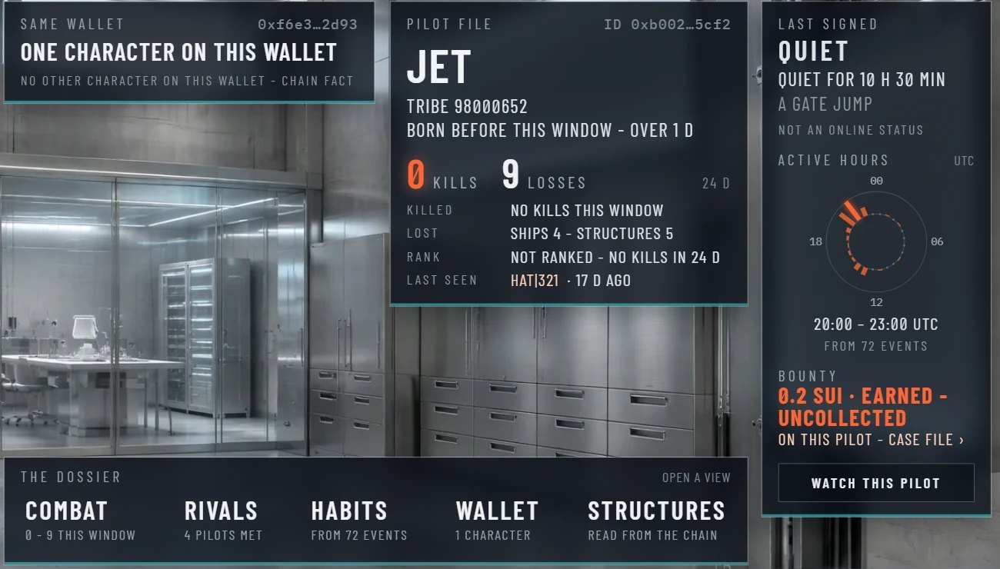
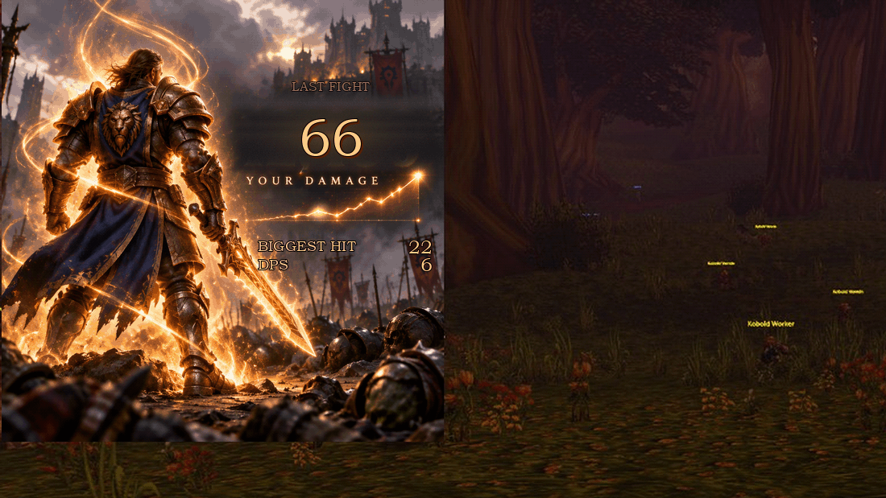

<picture>
  <source media="(prefers-color-scheme: dark)" srcset="assets/hero-dark.svg">
  <source media="(prefers-color-scheme: light)" srcset="assets/hero-light.svg">
  
</picture>

I'm Honey Badger, and I've been writing code since 1996 — two decades of game development and modding behind me. These days I build mods, servers and tools for the games I play, on my own.

The War Room, reading EVE Frontier's Stillness world from the chain. [Open it](https://honeybadger.software/frontier/warroom/).

### What's live

<picture>
  <source media="(prefers-color-scheme: dark)" srcset="assets/telemetry-dark.svg">
  <source media="(prefers-color-scheme: light)" srcset="assets/telemetry-light.svg">
  
</picture>

Rebuilt once a day by a GitHub Action from public Sui testnet reads: <a href="scripts/telemetry.mjs">scripts/telemetry.mjs</a>, <a href=".github/workflows/telemetry.yml">the workflow</a>. Daily counts, not a live feed. If one read fails it shows NOT READ; if every read fails, yesterday's panel stays up.

**24 Oct 2026.** The War Room and the Bounty Board are registered on the EVE Frontier Dapp Index. 
**22 Oct 2026.** War Room got three levels of detail on every page, measured kill delays, a map of charted systems and a back-fill of older killmails. 
**10 Oct 2026.** Named the Rust server Honey Badger and put my first plugin on it.

Earlier

**2 Oct 2026.** Battle Aura 3.1.1 for WoW Forever uploaded to CurseForge. WoWInterface has it too. 
**29 Sep 2026.** Republished the Bounty Board contract for Cycle 7.

### Background

Game development and modding since the early 2000s, starting at Valve — Half-Life 2, Counter-Strike 1.6 and Source, and Black Mesa — and mod work since across Counter-Strike: Global Offensive, Dota, Garry's Mod, and Unity. The mods and tools below are where that leads today.

### The mods

#### War Room &nbsp;EVE Frontier

PvP intel built from public chain events. It shows kills and killers, and how late each killmail reached the chain, which is often hours. The chain doesn't show who is online, and neither does the War Room.

React 19, TypeScript and Vite, reading Sui testnet through GraphQL and a gRPC-web stream, polling when the stream drops. &nbsp;[Open](https://honeybadger.software/frontier/warroom/) &nbsp;Source is private.

#### Bounty Board &nbsp;EVE Frontier

Post a bounty on any pilot. If the target loses a ship before it runs out, the contract lets the killer claim it, with the game's own killmail as proof. No platform fee, just network gas. Nobody has collected one yet, so that last step is still untested. "Earned" on the board means a kill qualified, not that it was paid.

Move contract `hb_bounty::bounty_board` on Sui testnet (Stillness), with a React front end. &nbsp;[Open](https://honeybadger.software/frontier/bounty/) &nbsp;[Source](https://github.com/honeybadger-software/eve-frontier-bounty-board)

#### Honey Badger &nbsp;Rust server

My own Rust server, running Carbon. The HUD across the top of these frames is mine. The gate and the vault were placed by my build plugin from saved layouts.

Build: places whole structures from saved layouts. &nbsp; Map Forge: edits terrain layers and saves a new .map. &nbsp; DPS HUD: damage, headshots, last hit, target, accuracy. &nbsp; TDM: two-team deathmatch.

C# plugins on Carbon, using the Oxide and Carbon plugin APIs. Listed in the Rust server browser under Modded, or from the F1 console: `client.connect 216.39.241.155:27915` &nbsp;Source is private.

#### Battle Aura &nbsp;WoW Forever

A personal damage meter with a battle scene behind the numbers. Total damage, biggest hit and DPS. Hits float up over the scene, and a banner marks a new personal best.

The addon's built-in `/ba test` preview, drawn by running its own Lua over a real fight capture. &nbsp;<a href="assets/battle-aura-in-game.jpg">The still from that fight</a>

Lua addon on Blizzard's own damage meter API (C_DamageMeter), so it works with Forever's restricted combat data. &nbsp;[CurseForge](https://www.curseforge.com/wow/addons/battle-aura) &nbsp;[WoWInterface](https://www.wowinterface.com/downloads/info27234-BattleAura.html) &nbsp;[Source](https://github.com/honeybadger-software/battle-aura)

#### EVE Fleet Foreman &nbsp;EVE Online

Free mining helper. Ranks ores by ISK per m³ from Jita prices, tells you whether to refine or sell, and works out the fleet split from the Mining Ledger.

Python and NiceGUI, with CCP's ESI and EVE SSO (PKCE) for the ledger and Fuzzwork for prices. &nbsp;[Download the Windows .exe](https://github.com/honeybadger-software/eve-fleet-foreman/releases/latest) &nbsp;[Source](https://github.com/honeybadger-software/eve-fleet-foreman)

### Software and industrial

I also build tools for machines: J1 Bridge for the Snapmaker J1 and OrcaSlicer, a CAN-bus dash for the C7 Corvette, and plant-floor dashboards that read blenders and PLCs. More at [honeybadger.software/industrial](https://honeybadger.software/industrial).

### Contact

[honeybadger.software](https://honeybadger.software) &nbsp; [@HoneyBadgerMods](https://x.com/HoneyBadgerMods) on X &nbsp; HONEYBADGERSOFTWARE in EVE Frontier

EVE Frontier material is used with limited permission of CCP Games. Not affiliated with or endorsed by CCP Games, Facepunch or Blizzard.
